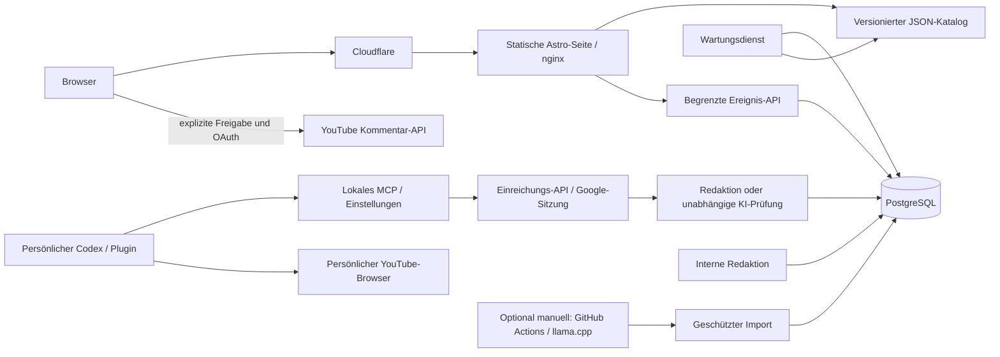

# Architektur und Schnittstellen

## Veröffentlichung

Zustände: `discovered → ready → review/published → withdrawn/expired`. Entdeckung enthält nur Metadaten. Erst die Redaktion hinterlegt einen vollständigen Kontext mit Fundstelle und wörtlichem Beleg. V1 extrahiert keine fremden Untertitel durch Scraping. Berechtigt verfügbare Transkripte können als `authorized_transcript` eingespielt werden.

Der Agent kann den freigegebenen Kontext nicht austauschen: Sein Import muss dem gespeicherten SHA-256-Digest entsprechen. Ein eindeutiger `runId`, eine atomare Statusänderung und Transaktion verhindern doppelte Verarbeitung. Automatische Veröffentlichung braucht aktivierte Konfiguration, freigegebene Betriebsflags, passende Modell-/Prompt-Digests, bestandene Kalibrierung, belegte Einordnung und aktuelle YouTube-Prüfung. Menschliche Veröffentlichung braucht dieselben Inhalts-/Verfügbarkeitsprüfungen, jedoch keine Modellkalibrierung.

Rücknahmen entfernen den Beitrag aus dem Katalog und invalidieren den CDN-Cache. Katalogexporte werden zwischen API und Worker per PostgreSQL Advisory Lock serialisiert und per Dateiumbenennung atomar ersetzt. Bei fehlgeschlagener CDN-Invalidierung liefert die API einen Fehler; Datenbankänderung und lokale Entfernung bleiben wirksam, Worker und Export-Schaltfläche versuchen die Invalidierung erneut. Der Katalog hat maximal 60 Sekunden Edge-TTL ohne unbegrenztes stale serving; jeder Beitrag hat zusätzlich eine im Browser geprüfte Ablaufzeit.

## Öffentliche Schnittstellen

- `GET /data/catalog.json`: `{version:1, generatedAt, demo:false, posts:[...]}`. Kein Rohtranskript oder Rohkommentar.
- `GET /data/stats.json`: Tagesaggregate als Gesamtzahlen, keine Besucherprofile.
- `GET /data/runtime.json`: kurzlebige Freigabe für optionales direktes Kommentieren. Ohne gültige Freigabe erfolgt kein API-Versand.
- `GET /api/commenting-status?postId=UUID`: frische, nicht cachebare Freigabe aus Datenbank und Angriffsmodus. Nur vor einem expliziten API-Kommentar erforderlich.
- `POST /api/events`: `{postId, type: 'original_open' | 'question_copy'}`. Gleicher Origin, nginx-Limit, Backend-Limit, begrenzte kurzlebige HMAC-Deduplizierung im RAM. Keine garantierte Botfreiheit und keine eindeutigen Personenstatistiken.

`expiresAt` liegt zwei Stunden nach der letzten erfolgreichen Verfügbarkeitsprüfung. Der Worker prüft veröffentlichte Videos spätestens stündlich. Ein API-Ausfall verlängert diese Frist nicht. Nach 30 Tagen werden Kandidaten samt verknüpften Analysen und Aggregaten gelöscht; redaktioneller Kontext muss dann neu überprüft werden.

## Interne Schnittstellen

Alle Datenrouten erfordern `Authorization: Bearer …`. `/internal/editor` liefert nur die interne Bedienoberfläche; das Token wird anschließend eingegeben und nicht persistiert. Der öffentliche nginx leitet keine internen Routen weiter.

| Route                       | Rolle           | Funktion                                                                          |
| --------------------------- | --------------- | --------------------------------------------------------------------------------- |
| `GET /internal/status`      | Redaktion       | Betriebsflags und Kalibrierungsstatus                                             |
| `GET /internal/candidates`  | Redaktion       | Letzte 100 Kandidaten                                                             |
| `POST /internal/editorial`  | Redaktion       | `{candidate, analysis?}` speichern; Metadaten und Kommentare gegen YouTube prüfen |
| `POST /internal/publish`    | Redaktion       | `{id}` nach Prüfung veröffentlichen                                               |
| `POST /internal/withdraw`   | Redaktion       | `{id}` zurückziehen                                                               |
| `POST /internal/flags`      | Redaktion       | `attack_mode` oder `publication_paused` setzen                                    |
| `POST /internal/export`     | Redaktion       | Katalog neu exportieren und CDN invalidieren                                      |
| `POST /internal/discover`   | Agent/Redaktion | Bis zu fünf Video-Metadaten dedupliziert speichern                                |
| `GET /internal/agent-batch` | Agent/Redaktion | Bis zu fünf vorbereitete Kontextdatensätze                                        |
| `POST /internal/import`     | Agent/Redaktion | Validierten Analyselauf importieren                                               |

Die exakten Zod-Verträge stehen in `src/lib/contracts.ts`. Agententokens dürfen keine Redaktionsaktionen ausführen. Keine Benutzerkennung gelangt über diese Schnittstellen in die Datenbank.

## Phase 2

`ProfilePreferences` reserviert Themen und `questionTone` (`factual`, `provocative`, `snarky`, `emotional`, `aggressive`). Standard `factual`; fehlende geprüfte Varianten haben einen expliziten sachlichen Ersatz. Keine Profiloberfläche, Synchronisierung, nicht-sachliche Generierung oder Rangliste in V1. Die Google-Pilotanmeldung ist eine begrenzte Anwendungsidentität. Die optionale YouTube-Autorisierung ist keine Portal-Identität.

## Beitrags- und Kommentarziele

Ein Kandidat kann `target: {type: "video"}` (auch der Standard für ältere Datensätze) oder `target: {type: "comment", commentId: "..."}` enthalten. Die Redaktion kann den direkten YouTube-Link mit `v` und `lc` im Editor übernehmen. Unterstützt werden Hauptkommentare; verschachtelte Antworten sind als Ziel nicht freigegeben. YouTube selbst hängt Antworten an den Hauptkommentar.

Das Backend prüft die Videozuordnung und liest Kommentartext, Verfassername und Avatar aus der API. Diese Angaben werden nicht vom Agenten erfunden. Der wörtliche Beleg wird bei Kommentarzielen gegen den ausgewählten Kommentar geprüft, beim Video gegen das Transkript. Bearbeitete oder gelöschte Kommentare werden nicht mit einer alten Analyse weiterveröffentlicht. Der öffentliche Akteursstatus gilt für den tatsächlichen Kommentarautor, nicht automatisch für den Videokanal.

Die Migration ersetzt die eindeutige Video-ID durch `source_key` (`video:ID` bzw. `comment:ID`), sodass mehrere geprüfte Ziele am selben Video bestehen können. Bestehende Kandidaten bleiben Videoziele. Verifizierte Autordaten stehen in `source_author`. Der öffentliche Katalog liefert nur das nötige Ziel, Anzeigename, Profil-Link und lokale Avatar-URL; keine komplette Kommentarstichprobe oder Roh-Avatar-URL.

Profilbilder werden nur von fest erlaubten YouTube-Bildhosts ohne Weiterleitungen geholt, auf 128 KiB und Rasterformate begrenzt und lokal gecacht. Ein fehlendes Bild hat einen sichtbaren lokalen Ersatz. Name und Original-Link bleiben erhalten. Der Cache wird täglich erneuert und nach spätestens 30 Tagen bereinigt.

Fragevorschläge verwenden einfache Alltagssprache, genau eine Frage, höchstens 16 Wörter und 180 Zeichen. Eigene Änderungen im Textfeld bleiben möglich. Der geänderte Prompt und Datenvertrag benötigen vor erneuter automatischer Freigabe eine neue Kalibrierung.

## Codex-Pilot

Der Standardablauf nutzt persönliche Codex-Zugänge der Teilnehmenden. Der lokale STDIO-MCP-Server führt keine Modellaufrufe aus und hält Einstellungen, Recherche und Versandhistorie außerhalb des Plugin-Pakets. Er reicht Ergebnisse über `POST /api/contributions` ein, falls die Person die standardmäßig aktivierte Einreichung nicht abschaltet. Die Erstellung erfolgt beim persönlichen Codex; eine separate, standardmäßig deaktivierte GitHub Action kann Einreichungen unabhängig nachprüfen.

Einreichungen sind getrennt von Kandidaten und internen Agentenimporten. Eine persönliche Google-Anwendungssitzung darf einreichen und eigene Freigaben abfragen; sie erteilt keine Social-Media-Berechtigungen. PostgreSQL serialisiert neue Einreichungen, idempotente Wiederholungen und das Tageslimit pro Schlüssel. Die Redaktion kann vollständige, selbst geprüfte Quellen in einen neuen Entwurf übernehmen. Alternativ bestätigt eine kalibrierte KI-Prüfung unabhängig abgerufene Originalquellen; vorhandene Kandidaten bleiben erhalten. Katalog und Plugin benötigen beide zentrale Bestätigung. Das Plugin reserviert den Versand erst nach frischer Freigabe des exakten aktuellen Fragetextes. Details: [Anmeldung und Freigabe](auth-review.md).

[Installation, vollständiger Vertrag, Einstellungen und Abnahme](codex-plugin.md).
