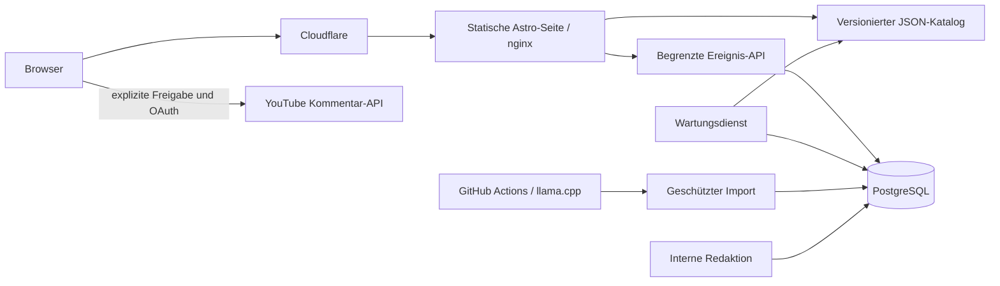

# Architektur und Schnittstellen

## Veröffentlichung

Zustände: `discovered → ready → review/published → withdrawn/expired`. Entdeckung enthält nur Metadaten. Erst die Redaktion hinterlegt einen vollständigen Kontext mit Fundstelle und wörtlichem Beleg. V1 extrahiert keine fremden Untertitel durch Scraping. Berechtigt verfügbare Transkripte können als `authorized_transcript` eingespielt werden.

Der Agent kann den freigegebenen Kontext nicht austauschen: Sein Import muss dem gespeicherten SHA-256-Digest entsprechen. Ein eindeutiger `runId`, eine atomare Statusänderung und Transaktion verhindern doppelte Verarbeitung. Automatische Veröffentlichung braucht aktivierte Konfiguration, freigegebene Betriebsflags, passende Modell-/Prompt-Digests, bestandene Kalibrierung, belegte Einordnung und aktuelle YouTube-Prüfung. Menschliche Veröffentlichung braucht dieselben Inhalts-/Verfügbarkeitsprüfungen, jedoch keine Modellkalibrierung.

Rücknahmen entfernen den Beitrag aus dem Katalog und invalidieren den CDN-Cache. Katalogexporte werden zwischen API und Worker per PostgreSQL Advisory Lock serialisiert und per Dateiumbenennung atomar ersetzt. Bei fehlgeschlagener CDN-Invalidierung liefert die API einen Fehler; Datenbankänderung und lokale Entfernung bleiben wirksam, Worker und Export-Schaltfläche versuchen die Invalidierung erneut. Der Katalog hat maximal 60 Sekunden Edge-TTL ohne unbegrenztes stale serving; jeder Beitrag hat zusätzlich eine im Browser geprüfte Ablaufzeit.

## Öffentliche Schnittstellen

- `GET /data/catalog.json`: `{version:1, generatedAt, demo:false, posts:[...]}`. Kein Rohtranskript oder Rohkommentar.
- `GET /data/stats.json`: Tagesaggregate als Gesamtzahlen, keine Besucherprofile.
- `GET /data/runtime.json`: kurzlebige Freigabe für optionales direktes Kommentieren. Ohne gültige Freigabe erfolgt kein API-Versand.
- `GET /api/commenting-status?postId=UUID`: frische, nicht cachebare Freigabe aus Datenbank und Angriffsmodus. Nur vor einem expliziten API-Kommentar erforderlich.
- `POST /api/events`: `{postId, type: 'original_open' | 'question_copy'}`. Gleicher Origin, nginx-Limit, Backend-Limit, begrenzte kurzlebige HMAC-Deduplizierung im RAM. Keine garantierte Botfreiheit und keine eindeutigen Personenstatistiken.

`expiresAt` liegt zwei Stunden nach der letzten erfolgreichen Verfügbarkeitsprüfung. Der Worker prüft veröffentlichte Videos spätestens stündlich. Ein API-Ausfall verlängert diese Frist nicht. Nach 30 Tagen werden Kandidaten samt verknüpften Analysen und Aggregaten gelöscht; redaktioneller Kontext muss dann neu überprüft werden.

## Interne Schnittstellen

Alle Datenrouten erfordern `Authorization: Bearer …`. `/internal/editor` liefert nur die interne Bedienoberfläche; das Token wird anschließend eingegeben und nicht persistiert. Der öffentliche nginx leitet keine internen Routen weiter.

| Route                       | Rolle           | Funktion                                                                          |
| --------------------------- | --------------- | --------------------------------------------------------------------------------- |
| `GET /internal/status`      | Redaktion       | Betriebsflags und Kalibrierungsstatus                                             |
| `GET /internal/candidates`  | Redaktion       | Letzte 100 Kandidaten                                                             |
| `POST /internal/editorial`  | Redaktion       | `{candidate, analysis?}` speichern; Metadaten und Kommentare gegen YouTube prüfen |
| `POST /internal/publish`    | Redaktion       | `{id}` nach Prüfung veröffentlichen                                               |
| `POST /internal/withdraw`   | Redaktion       | `{id}` zurückziehen                                                               |
| `POST /internal/flags`      | Redaktion       | `attack_mode` oder `publication_paused` setzen                                    |
| `POST /internal/export`     | Redaktion       | Katalog neu exportieren und CDN invalidieren                                      |
| `POST /internal/discover`   | Agent/Redaktion | Bis zu fünf Video-Metadaten dedupliziert speichern                                |
| `GET /internal/agent-batch` | Agent/Redaktion | Bis zu fünf vorbereitete Kontextdatensätze                                        |
| `POST /internal/import`     | Agent/Redaktion | Validierten Analyselauf importieren                                               |

Die exakten Zod-Verträge stehen in `src/lib/contracts.ts`. Agententokens dürfen keine Redaktionsaktionen ausführen. Keine Benutzerkennung gelangt über diese Schnittstellen in die Datenbank.

## Phase 2

`ProfilePreferences` reserviert Themen und `questionTone` (`factual`, `provocative`, `snarky`, `emotional`, `aggressive`). Standard `factual`; fehlende geprüfte Varianten haben einen expliziten sachlichen Ersatz. Keine Oberfläche, Nutzerkonten, Synchronisierung, nicht-sachliche Generierung oder Rangliste in V1. Die optionale YouTube-Autorisierung ist keine Portal-Identität.
